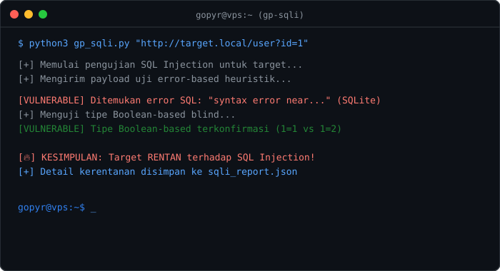

# GP-SQLi

[](https://opensource.org/licenses/MIT)
[](https://www.python.org/)

GP-SQLi mendeteksi dan memverifikasi celah SQL Injection di parameter GET aplikasi web. Dibuat dengan Python murni, tanpa dependensi tambahan. Cara kerjanya sederhana: kirim payload, lalu baca respons server untuk mencari celah error-based dan boolean-based blind.



## Fitur

- Jalankan `python3 gp_sqli.py` tanpa argumen untuk masuk ke menu interaktif dengan logo By Gopyr.
- Deteksi error-based: mengirim payload pemicu error untuk MySQL, PostgreSQL, MS SQL, SQLite, dan Oracle.
- Validasi boolean-blind: menguji variasi logika benar/salah untuk memastikan celahnya benar-benar ada, bukan sekadar error biasa.
- Hasil pengujian beserta buktinya disimpan dalam file JSON.

## Cara Penggunaan

Mode interaktif:
```bash
python3 gp_sqli.py
```

Mode command line:
```bash
python3 gp_sqli.py "http://testphp.vulnweb.com/listproducts.php?cat=1" --output report.json
```

## Disclaimer

Ini tool pengujian keamanan ofensif. Uji hanya sistem milik Anda sendiri atau sistem yang memberi izin tertulis. Penyalahgunaan untuk aktivitas ilegal adalah tanggung jawab pengguna, bukan pengembang.

## Lisensi

[MIT License](LICENSE)
